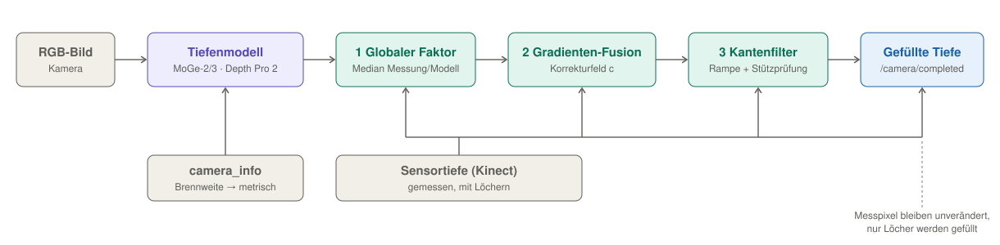
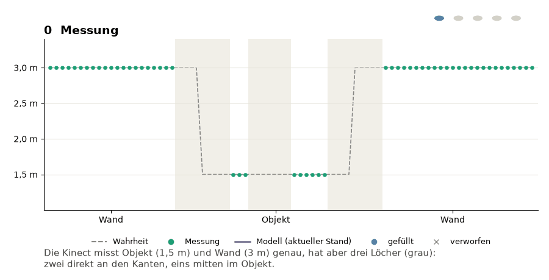
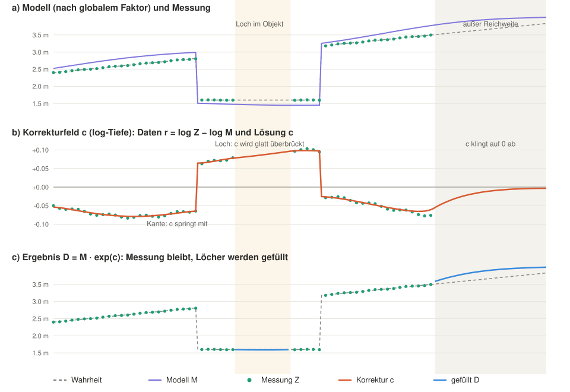
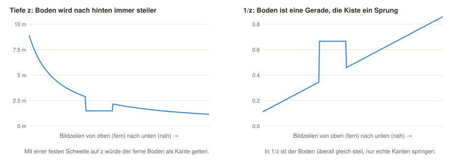
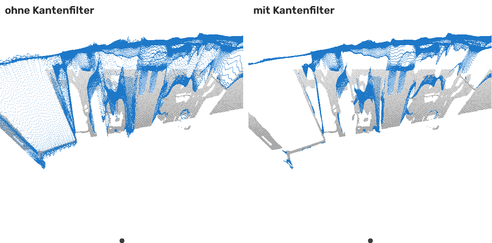

# Tiefenvervollständigung: Kinect-Tiefe mit einem KI-Modell auffüllen

Die Azure Kinect misst Tiefe sehr genau, lässt aber viele Löcher: an Objektkanten, auf dunklen
oder glänzenden Flächen, an Glas und jenseits ihrer Reichweite. In der Karte (nvblox) wären das
Bereiche ohne Information. Schritt 3 der Pipeline (`depth_completion_node.py`) füllt diese
Löcher. Dafür schätzt ein monokulares Tiefenmodell die Tiefe aus dem RGB-Bild, und diese
Schätzung wird an die echten Messungen angepasst.

Grundregeln:

- **Gemessene Pixel bleiben immer unverändert.** Gefüllt werden nur Löcher.
- **Im Zweifel bleibt ein Loch.** Ein fehlender Punkt ist für die Karte harmlos, ein falscher
  Punkt in der Luft nicht.



| Schritt | Was passiert | Code |
|---|---|---|
| Tiefenmodell | schätzt aus dem RGB-Bild eine metrische Tiefe für **jedes** Pixel | `depth_models.py` |
| 1 Globaler Faktor | bringt die Schätzung grob auf den Maßstab der Messung | `depth_fusion.fill` |
| 2 Gradienten-Fusion | passt die Schätzung lokal an die Messungen an, ohne ihre Form zu zerstören | `depth_fusion.GradientFusion` |
| 3 Kantenfilter | verwirft gefüllte Pixel an Tiefenkanten, die als schwebende Punkte enden würden | `depth_fusion.jump_edges` |

So läuft das an einer einzelnen Bildzeile ab: ein Objekt in 1,5 m vor einer Wand in 3 m, mit drei
Löchern in der Messung (vereinfacht, 80 Pixel statt 1280):



## Installation

Ein conda-Env für Knoten, Viewer und Benchmark mit allen Modellen, für Linux mit NVIDIA-GPU und
ROS 2 Jazzy.

- Die Python-Version muss zur ROS-Distribution passen (Jazzy: 3.12), sonst lässt sich `rclpy`
  nicht importieren.
- numpy muss unter 2 bleiben, weil die ROS-Nachrichtentypen gegen numpy 1.x gebaut sind. MoGe wird
  deshalb ohne Abhängigkeiten installiert, OpenCV unter 4.12 gehalten.

**1. Env anlegen**

```bash
conda create -y -n depthcompletion python=3.12
```

```bash
conda activate depthcompletion
```

**2. PyTorch** (CUDA-Version passend zum Treiber wählen, siehe `nvidia-smi` und pytorch.org)

```bash
pip install torch torchvision --index-url https://download.pytorch.org/whl/cu128
```

**3. Gemeinsame Pakete** (inklusive `rerun-sdk` für den Viewer)

```bash
pip install "numpy<2" "opencv-python-headless<4.12" scipy trimesh "huggingface-hub>=1.0" click requests tqdm pillow matplotlib rosbags rerun-sdk
```

**4. MoGe**

```bash
pip install "numpy<2" "utils3d_moge @ git+https://github.com/EasternJournalist/utils3d-moge.git@62f09d58509485564e24d5d9f6aac9ee9ebc0c37" "pipeline @ git+https://github.com/EasternJournalist/pipeline.git@1c511390d90226c00c101f34b84df26a0f8789b4"
```

```bash
pip install --no-deps "git+https://github.com/microsoft/MoGe.git@74fbce054ebed49800de42d0ad0e83495065719a"
```

**5. Depth Pro 2**

```bash
pip install "numpy<2" "git+https://github.com/apple-aiml-research/ml-depth-pro-2.git@aa389cbb0b74341664ed663a0966c859905cd6c0"
```

**6. Optional: MoGe-3-Verfeinerung** (nur CUDA, braucht das CUDA-Toolkit; ohne läuft MoGe-3 mit
seinem Basisnetz)

```bash
pip install --no-build-isolation "git+https://github.com/JeffreyXiang/FlexGEMM.git@b2fadb29d41846c7981ade6801ffc689fae119cf"
```

**7. Prüfen** (ROS gesourct, im Repo-Hauptordner)

```bash
python -c "import torch, numpy, rclpy, sensor_msgs.msg; print(torch.cuda.is_available(), numpy.__version__)"
```

```bash
python -c "import sys; sys.path.insert(0, 'navigation/mapping/depth_completion'); from depth_models import load_model; print(load_model('moge2-b', 600).dev)"
```

In einem bereits bestehenden Env fehlt für den neuen Viewer nur Rerun:

```bash
pip install rerun-sdk
```

Der Viewer öffnet ein eigenes Rerun-Fenster und braucht deshalb einen Bildschirm. Ohne Bildschirm
(z. B. per SSH) mit `--save f.rrd` aufzeichnen und die Datei später mit `rerun f.rrd` öffnen.

Die Gewichte werden beim ersten Start geladen (`~/.cache/huggingface`,
`~/.cache/torch/hub/checkpoints`). Im LN-Prozessmanager das Env-Python direkt eintragen
(`<conda>/envs/depthcompletion/bin/python`), nicht `conda run`.

## Beispiel

Eine Aufnahme aus dem Labor (MoGe-2 B, 600 Tokens):


1. **RGB**: das Kamerabild, aus dem das Modell schätzt.
2. **Sensor**: Kinect-Tiefe. Schwarz sind Löcher, hier 37 % des Bildes. Oben fehlt alles
   jenseits der Reichweite, dazu Löcher an den Rollstühlen und an Kanten.
3. **Modell × globaler Faktor**: Die Schätzung deckt das ganze Bild ab, Kanten sind weich.
4. **Gefüllt**: Messung plus gefüllte Löcher. Magenta sind die Pixel, die der Kantenfilter
   verworfen hat, sie bleiben leer. Hier sind 95 % des Bildes gefüllt, 5 % verworfen.

## Tiefenschätzung: welche Modelle es gibt

Alle Modelle stecken hinter einer gemeinsamen Schnittstelle in `depth_models.py`:

```python
model = load_model("moge2-b", num_tokens=600)
depth = model(rgb, fov_x)   # RGB (H, W, 3) und Sichtfeld -> Tiefe [m] je Pixel, ungültig = inf
```

Das Modell bekommt das RGB-Bild und das horizontale Sichtfeld der Kamera. Das Sichtfeld wird
aus der Brennweite in `camera_info` berechnet. Mit der echten Brennweite liefern die Modelle
direkt **metrische** Tiefe in Metern, statt nur relative Tiefe. Wie die Netze intern
funktionieren, spielt hier keine Rolle; wichtig ist nur, dass sie die Form der Szene gut treffen,
Maßstab und Kanten aber nicht perfekt.

| Name | Modell | Paket | Hinweis |
|---|---|---|---|
| `moge2-s` | MoGe-2 vits-normal | `moge` | am schnellsten |
| **`moge2-b`** | **MoGe-2 vitb-normal** | `moge` | **Standard im ROS-Knoten** |
| `moge` | MoGe-2 vitl | `moge` | genauer, langsamer |
| `moge3-l` | MoGe-3 vitl | `moge` | Verfeinerung nur mit CUDA, sonst nur Basisnetz |
| `depthpro2-s` | Apple Depth Pro 2 S | `depth_pro_2` | Gewichte nur für Forschung |
| `depthpro2-b` | Apple Depth Pro 2 B | `depth_pro_2` | Gewichte nur für Forschung |
| `depthpro2-l` | Apple Depth Pro 2 L | `depth_pro_2` | am genauesten, Gewichte nur für Forschung |
| `depthpro2-h` | Apple Depth Pro 2 H+ | `depth_pro_2` | sehr groß (3,5 GB) |

Laufzeit und Genauigkeit der Modelle: [bench/README.md](bench/README.md).

Einstellungen:

- **MoGe**: `num_tokens` bestimmt die Auflösung, mit der das Netz rechnet. Mehr Tokens heißt
  genauer und langsamer; die Ausgabe hat immer die volle Bildgröße.
- **Depth Pro 2**: rechnet immer in voller Auflösung. Mit `stream=True` (Viewer: `--stream`)
  sieht das Modell zusätzlich die 15 Bilder davor und wird zeitlich ruhiger.
- **Auswahl**: im ROS-Knoten oben `MODEL` und `NUM_TOKENS`, im Viewer `--model` und
  `--num-tokens`.

Pixel, die das Modell selbst als ungültig markiert (z. B. Himmel) oder die weiter als 50 m
entfernt sind, bekommen `inf` und werden nicht gefüllt.

## Fusion: Schätzung an die Messung anpassen

Die Modelltiefe M hat zwei typische Fehler. Ihr **Maßstab** liegt ein paar Prozent daneben, und
das nicht überall gleich: Ein Objekt kann 5 % zu nah, die Wand dahinter 4 % zu fern sein. Die
**Form** dagegen (welche Fläche eben ist, wo eine Kante ist) trifft sie gut. Die Fusion nimmt
deshalb die Form vom Modell und den Maßstab von der Messung.

### Schritt 1: globaler Faktor

Der Median von Messung/Modell über alle Pixel, an denen beides vorhanden ist, ergibt einen
Faktor s. Er wird über die Zeit geglättet (`ema = 0.3`), damit er nicht springt. Danach stimmt
die Schätzung im Mittel, aber noch nicht lokal.

### Schritt 2: Gradienten-Fusion mit Korrekturfeld

Gesucht ist ein Korrekturfeld c, mit dem das gefüllte Bild D = M · exp(c) ist. Die Rechnung läuft
in log-Tiefe, so ist c ein relativer Faktor: c = 0,05 heißt 5 % weiter weg. c soll drei Dinge
gleichzeitig erfüllen:

1. **Messung treffen**: Wo die Kinect misst, soll c ≈ r = log Z − log M sein.
2. **Glatt entlang von Flächen**: Benachbarte Pixel sollen fast dasselbe c haben, aber **nicht
   über Kanten** des Modells hinweg. An einer Kante wird die Kopplung schwach
   (Gewicht exp(−|Δ log M| / `sigma_edge`)), das Objekt bekommt also seine eigene Korrektur und
   die Wand ihre eigene.
3. **Abklingen**: Ohne Messungen in der Nähe wird c langsam zu 0 gezogen, jenseits der
   Reichweite stärker. Dort bleibt dann die Modelltiefe mit globalem Faktor.

Das ist ein lineares Ausgleichsproblem. Am besten sieht man es an einer einzelnen Bildzeile. Die
Kurven unten sind mit genau dieser Gleichung gerechnet, nicht gezeichnet:



- **a)** Das Modell (violett) hat die richtige Form, liegt aber beim Objekt zu nah und bei der
  Wand zu fern. Die Kinect (grün) hat ein Loch im Objekt (gelb) und misst rechts nichts mehr
  (grau).
- **b)** Grün ist, um wie viel das Modell an jeder Messung danebenliegt (r). Die Lösung c (orange)
  folgt diesen Punkten. Im Loch wird sie glatt überbrückt, an der Objektkante springt sie mit,
  und rechts klingt sie auf 0 ab.
- **c)** Ergebnis: Die Messung bleibt, das Loch im Objekt wird bis auf unter 1 % genau gefüllt
  (ohne Korrektur wären es 9,5 % Fehler). Rechts, ohne jede Messung in der Nähe, bleibt der
  Modellfehler stehen; dort kann keine Fusion etwas korrigieren.

Umsetzung (`GradientFusion`):

- Gerechnet wird auf einem Gitter mit halber Auflösung (`down = 2`). Jede Gitterzelle bekommt
  ein Messgewicht aus Abdeckung, Sensorgenauigkeit (fällt ab 4 m mit 1/z² ab), Streuung in der
  Zelle (Kanten) und Ausreißerprüfung gegen den Median.
- Gelöst wird mit vorkonditioniertem CG (konjugierte Gradienten) auf der GPU, 40 Iterationen.
  Startwert ist das c des letzten Frames, das beschleunigt im Live-Betrieb.
- Ein zweiter Durchgang mit Huber-Gewichten dämpft einzelne falsche Messungen.
- c wird kantentreu auf volle Auflösung gebracht: Beim Hochskalieren zählen nur Gitterpunkte
  mit ähnlicher Modelltiefe, damit c nicht über Kanten verschmiert.

| Parameter | Standard | Bedeutung |
|---|---|---|
| `down` | 2 | Gitterverkleinerung |
| `lam` | 1.0 | Stärke der Glattheit |
| `sigma_edge` | 0.05 | ab welchem Sprung in log M eine Kante die Kopplung löst |
| `mu_near`, `mu_far`, `far_band` | 1e-4, 0.005, 0.15 | Abklingen nah / hinter dem Messbereich |
| `z_ref` | 4.0 m | ab hier sinkt das Vertrauen in die Messung mit 1/z² |
| `outlier` | 1.0 | Ausreißerschwelle (log-Einheiten) |
| `iters` | 40 | CG-Iterationen |

### Schritt 3: Kantenfilter gegen schwebende Punkte

Das Modell zeichnet einen Tiefensprung nicht als Stufe, sondern als **weiche Rampe** über 10 bis
30 Pixel, wie ein unscharfes Foto. Genau an Kanten misst die Kinect oft nichts. Ohne Filter würde
die Rampe eingefüllt: Werte wie 1,9 m oder 2,4 m zwischen einem Objekt in 1,5 m und der Wand in
3 m. In der Karte sind das Punkte, die zwischen Objekt und Wand in der Luft schweben
(Kanten-Bleeding).

Der Filter macht drei einfache Schritte: **Kante finden → Zone um die Kante → dort nichts
füllen.**

1. **Kante finden**: In der korrigierten Modelltiefe wird für jedes Pixel geschaut, wie stark
   sich 1/Tiefe im 5×5-Fenster ändert. Springt sie um mehr als `edge_jump` (0,015 1/m), liegt
   dort eine Kante. Der Sprung von 1,5 m auf 3 m ist in 1/Tiefe 0,67 → 0,33, also weit darüber.
2. **Zone**: Die Kante wird um `edge_grow` (4 px) aufgebläht, damit auch die flachen Enden der
   Rampe dazugehören.
3. **Nicht füllen**: Gefüllte Pixel in der Zone werden verworfen und bleiben leer. Gemessene
   Pixel bleiben immer.


**Warum 1/Tiefe und nicht die Tiefe selbst?** Der Boden läuft flach von der Kamera weg. In der
Tiefe wird er nach hinten immer steiler, ein fester Schwellwert würde den fernen Boden als Kante
verwerfen. In 1/Tiefe ist jede ebene Fläche eine Gerade: Der Boden ist in jeder Entfernung gleich
steil und bleibt unter der Schwelle, nur echte Kanten springen darüber.



So sieht das in 3D von oben aus. Grau ist gemessen, blau gefüllt, der Boden ist ausgeblendet:



Ohne Filter (links) hängen Schleier aus gefüllten Punkten zwischen den Objekten und der Wand.
Mit Filter (rechts) sind sie weg; die gefüllten Flächen in den Objekten bleiben.

**Grenzen**

- In der Zone um Kanten bleibt die Tiefe leer. Von den Löchern direkt an Tiefenkanten wird etwa
  ein Fünftel gefüllt (21 %). Ein kleiner Rest bleibt: 0,04 % der Kantenpixel werden noch
  mit mehr als 10 % Fehler gefüllt. Mit `edge_grow=8` sind es 0 %, dafür werden 7 Prozentpunkte
  weniger der echten Löcher gefüllt.
- Sehr nahe Flächen, auf die man fast genau von der Seite schaut (z. B. eine Wand, an der der
  Roboter in weniger als ~0,5 m Abstand entlangfährt), ändern sich in 1/Tiefe ebenfalls stark
  und werden als Kante verworfen. Links in der Draufsicht fällt eine schräg gesehene Fläche weg,
  vermutlich so ein Fall.

| Parameter | Standard | Bedeutung |
|---|---|---|
| `edge_jump` | 0.015 1/m | ab welchem Sprung in 1/Tiefe (im 5×5-Fenster) eine Kante vorliegt, 0 = Filter aus |
| `edge_grow` | 4 px | Breite der Zone um eine Kante, in der nichts gefüllt wird (8 px: kein Bleeding mehr, aber weniger Fläche) |

## Code und Werkzeuge

| Datei | Inhalt |
|---|---|
| `depth_models.py` | Modelle, `load_model(name)` |
| `depth_fusion.py` | `fill` (Schritte 1–3), `global_scale`, `GradientFusion`, `jump_edges` |
| `depth_completion_node.py` | ROS-Knoten (Schritt 3 der Pipeline) |
| `viewer.py` | Rerun-Fenster: RGB, Sensor-, Modell- und gemergte Tiefe plus je eine 3D-Punktwolke; live über ROS oder offline mit `--frames f.npz`. Verworfene Pixel magenta, gefüllte Punkte in RGB (mit `--mark-filled` orange), Filter mit `--set edge_jump=0` abschaltbar, `--eval` zeigt den Fehler unter 3 m als Kurve |
| `bench/` | Offline-Benchmark ohne ROS mit eigener Doku und allen Messergebnissen: [bench/README.md](bench/README.md) |

```bash
python navigation/mapping/depth_completion/viewer.py --model moge2-b --num-tokens 600
```
