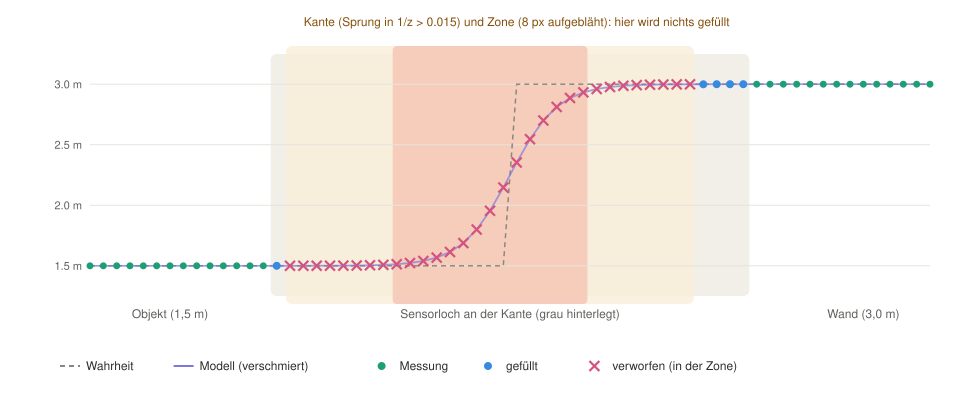
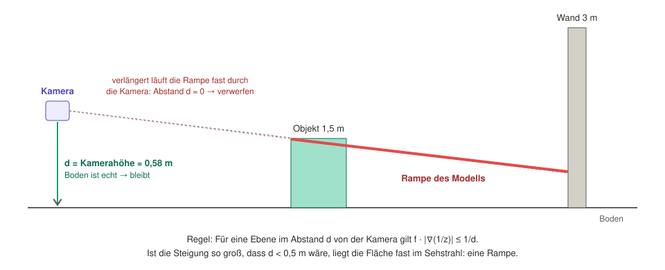

# Tiefenvervollständigung: Kinect-Tiefe mit einem KI-Modell auffüllen

Die Azure Kinect misst Tiefe sehr genau, lässt aber viele Löcher: an Objektkanten, auf dunklen
oder glänzenden Flächen, an Glas und jenseits ihrer Reichweite. In der Karte (nvblox) wären das
Bereiche ohne Information. Schritt 3 der Pipeline (`depth_completion_node.py`) füllt diese
Löcher. Dafür schätzt ein monokulares Tiefenmodell die Tiefe aus dem RGB-Bild, und diese
Schätzung wird an die echten Messungen angepasst.

Grundregeln:

- **Gemessene Pixel bleiben immer unverändert.** Gefüllt werden nur Löcher.
- **Im Zweifel bleibt ein Loch.** Ein fehlender Punkt ist für die Karte harmlos, ein falscher
  Punkt in der Luft nicht.


| Schritt | Was passiert | Code |
|---|---|---|
| Tiefenmodell | schätzt aus dem RGB-Bild eine metrische Tiefe für **jedes** Pixel | `depth_models.py` |
| 1 Globaler Faktor | bringt die Schätzung grob auf den Maßstab der Messung | `depth_fusion.fill` |
| 2 Gradienten-Fusion | passt die Schätzung lokal an die Messungen an, ohne ihre Form zu zerstören | `depth_fusion.GradientFusion` |
| 3 Kantenfilter | verwirft gefüllte Pixel, die als schwebende Punkte enden würden | `depth_fusion.ramp_mask`, `supported` |

## Beispiel

Eine Aufnahme aus dem Labor (MoGe-2 B, 600 Tokens):


1. **RGB**: das Kamerabild, aus dem das Modell schätzt.
2. **Sensor**: Kinect-Tiefe. Schwarz sind Löcher, hier 37 % des Bildes. Oben fehlt alles
   jenseits der Reichweite, dazu Löcher an den Rollstühlen und an Kanten.
3. **Modell × globaler Faktor**: Die Schätzung deckt das ganze Bild ab, Kanten sind weich.
4. **Gefüllt**: Messung plus gefüllte Löcher. Magenta sind die Pixel, die der Kantenfilter
   verworfen hat, sie bleiben leer. Hier sind 96 % des Bildes gefüllt, 4 % verworfen.

## Tiefenschätzung: welche Modelle es gibt

Alle Modelle stecken hinter einer gemeinsamen Schnittstelle in `depth_models.py`:

```python
model = load_model("moge2-b", num_tokens=600)
depth = model(rgb, fov_x)   # RGB (H, W, 3) und Sichtfeld -> Tiefe [m] je Pixel, ungültig = inf
```

Das Modell bekommt das RGB-Bild und das horizontale Sichtfeld der Kamera. Das Sichtfeld wird
aus der Brennweite in `camera_info` berechnet. Mit der echten Brennweite liefern die Modelle
direkt **metrische** Tiefe in Metern, statt nur relative Tiefe. Wie die Netze intern
funktionieren, spielt hier keine Rolle; wichtig ist nur, dass sie die Form der Szene gut treffen,
Maßstab und Kanten aber nicht perfekt.

| Name | Modell | Paket | Hz auf M4 Pro* | Fehler < 3 m, große Löcher** | Hinweis |
|---|---|---|---|---|---|
| `moge2-s` | MoGe-2 vits-normal | `moge` | 11,8 (600 Tokens) | 3,8 % | am schnellsten |
| **`moge2-b`** | **MoGe-2 vitb-normal** | `moge` | **9,4 (600 Tokens)** | **3,1 %** | **Standard im ROS-Knoten (8-Hz-Ziel)** |
| `moge` | MoGe-2 vitl | `moge` | 3,3 (1200 Tokens) | 1,9 % | genauer, langsamer |
| `moge3-l` | MoGe-3 vitl | `moge` | – | – | Verfeinerung nur mit CUDA, sonst nur Basisnetz |
| `depthpro2-s` | Apple Depth Pro 2 S | `depth_pro_2` | 6,5 | 3,4 % | Gewichte nur für Forschung |
| `depthpro2-b` | Apple Depth Pro 2 B | `depth_pro_2` | 2,9 | 2,2 % | Gewichte nur für Forschung |
| `depthpro2-l` | Apple Depth Pro 2 L | `depth_pro_2` | 1,0 | 1,6 % | am genauesten, Forschungslizenz |
| `depthpro2-h` | Apple Depth Pro 2 H+ | `depth_pro_2` | – | – | sehr groß (3,5 GB) |

\* Modell plus Füllung, 1280×720, Apple M4 Pro (MPS). Auf einer CUDA-GPU deutlich schneller.
\** Mittlerer relativer Fehler in ausgeblendeten 128-px-Löchern, 6 Aufnahmen (`bench/`).

Einstellungen:

- **MoGe**: `num_tokens` bestimmt die Auflösung, mit der das Netz rechnet. Mehr Tokens heißt
  genauer und langsamer; die Ausgabe hat immer die volle Bildgröße.
- **Depth Pro 2**: rechnet immer in voller Auflösung. Mit `stream=True` (Viewer: `--stream`)
  sieht das Modell zusätzlich die 15 Bilder davor und wird zeitlich ruhiger.
- **Auswahl**: im ROS-Knoten oben `MODEL` und `NUM_TOKENS`, im Viewer `--model` und
  `--num-tokens`.

Pixel, die das Modell selbst als ungültig markiert (z. B. Himmel) oder die weiter als 50 m
entfernt sind, bekommen `inf` und werden nicht gefüllt.

## Fusion: Schätzung an die Messung anpassen

Die Modelltiefe M hat zwei typische Fehler. Ihr **Maßstab** liegt ein paar Prozent daneben, und
das nicht überall gleich: Ein Objekt kann 5 % zu nah, die Wand dahinter 4 % zu fern sein. Die
**Form** dagegen (welche Fläche eben ist, wo eine Kante ist) trifft sie gut. Die Fusion nimmt
deshalb die Form vom Modell und den Maßstab von der Messung.

### Schritt 1: globaler Faktor

Der Median von Messung/Modell über alle Pixel, an denen beides vorhanden ist, ergibt einen
Faktor s. Er wird über die Zeit geglättet (`ema = 0.3`), damit er nicht springt. Danach stimmt
die Schätzung im Mittel, aber noch nicht lokal.

### Schritt 2: Gradienten-Fusion mit Korrekturfeld

Gesucht ist ein Korrekturfeld c, mit dem das gefüllte Bild D = M · exp(c) ist. Die Rechnung läuft
in log-Tiefe, so ist c ein relativer Faktor: c = 0,05 heißt 5 % weiter weg. c soll drei Dinge
gleichzeitig erfüllen:

1. **Messung treffen**: Wo die Kinect misst, soll c ≈ r = log Z − log M sein.
2. **Glatt entlang von Flächen**: Benachbarte Pixel sollen fast dasselbe c haben, aber **nicht
   über Kanten** des Modells hinweg. An einer Kante wird die Kopplung schwach
   (Gewicht exp(−|Δ log M| / `sigma_edge`)), das Objekt bekommt also seine eigene Korrektur und
   die Wand ihre eigene.
3. **Abklingen**: Ohne Messungen in der Nähe wird c langsam zu 0 gezogen, jenseits der
   Reichweite stärker. Dort bleibt dann die Modelltiefe mit globalem Faktor.

Das ist ein lineares Ausgleichsproblem. Am besten sieht man es an einer einzelnen Bildzeile. Die
Kurven unten sind mit genau dieser Gleichung gerechnet, nicht gezeichnet:


- **a)** Das Modell (violett) hat die richtige Form, liegt aber beim Objekt zu nah und bei der
  Wand zu fern. Die Kinect (grün) hat ein Loch im Objekt (gelb) und misst rechts nichts mehr
  (grau).
- **b)** Grün ist, um wie viel das Modell an jeder Messung danebenliegt (r). Die Lösung c (orange)
  folgt diesen Punkten. Im Loch wird sie glatt überbrückt, an der Objektkante springt sie mit,
  und rechts klingt sie auf 0 ab.
- **c)** Ergebnis: Die Messung bleibt, das Loch im Objekt wird bis auf unter 1 % genau gefüllt
  (ohne Korrektur wären es 9,5 % Fehler). Rechts, ohne jede Messung in der Nähe, bleibt der
  Modellfehler stehen; dort kann keine Fusion etwas korrigieren.

Umsetzung (`GradientFusion`):

- Gerechnet wird auf einem Gitter mit halber Auflösung (`down = 2`). Jede Gitterzelle bekommt
  ein Messgewicht aus Abdeckung, Sensorgenauigkeit (fällt ab 4 m mit 1/z² ab), Streuung in der
  Zelle (Kanten) und Ausreißerprüfung gegen den Median.
- Gelöst wird mit vorkonditioniertem CG (konjugierte Gradienten) auf der GPU, 40 Iterationen.
  Startwert ist das c des letzten Frames, das beschleunigt im Live-Betrieb.
- Ein zweiter Durchgang mit Huber-Gewichten dämpft einzelne falsche Messungen.
- c wird kantentreu auf volle Auflösung gebracht: Beim Hochskalieren zählen nur Gitterpunkte
  mit ähnlicher Modelltiefe, damit c nicht über Kanten verschmiert.
- Laufzeit: ~24 ms pro Frame auf MPS (inklusive Kantenfilter).

| Parameter | Standard | Bedeutung |
|---|---|---|
| `down` | 2 | Gitterverkleinerung |
| `lam` | 1.0 | Stärke der Glattheit |
| `sigma_edge` | 0.05 | ab welchem Sprung in log M eine Kante die Kopplung löst |
| `mu_near`, `mu_far`, `far_band` | 1e-4, 0.005, 0.15 | Abklingen nah / hinter dem Messbereich |
| `z_ref` | 4.0 m | ab hier sinkt das Vertrauen in die Messung mit 1/z² |
| `outlier` | 1.0 | Ausreißerschwelle (log-Einheiten) |
| `iters` | 40 | CG-Iterationen |

### Schritt 3: Kantenfilter gegen schwebende Punkte

Das Modell zeichnet einen Tiefensprung nicht als Stufe, sondern als **weiche Rampe** über 10 bis
30 Pixel, wie ein unscharfes Foto. Genau an Kanten misst die Kinect oft nichts. Ohne Filter würde
die Rampe eingefüllt: Werte wie 1,9 m oder 2,4 m zwischen einem Objekt in 1,5 m und der Wand in
3 m. In der Karte sind das Punkte, die zwischen Objekt und Wand in der Luft schweben
(Kanten-Bleeding).

Der Filter arbeitet nach dem Prinzip **Kante finden → Zone um die Kante → dort prüfen**, in zwei
Schritten:



**Schritt 1, zu steil, um echt zu sein (`ramp_mask`).** Auf der Rampe ändert sich die Tiefe von
Pixel zu Pixel um viele Zentimeter. Eine echte Fläche sieht im Bild nur dann so steil aus, wenn
man fast genau an ihr entlang schaut. Geometrisch: Für eine Ebene mit Abstand d zur Kamera gilt
f · |∇(1/z)| ≤ 1/d. Eine Rampe läuft verlängert fast durch die Kamera (d ≈ 0), echte Flächen
nicht.



Verworfen wird, was einer Fläche mit d < 0,5 m (`ramp_dmin`) entspräche. Der Boden bleibt in
jeder Entfernung erhalten, denn sein Abstand ist die Kamerahöhe (≈ 0,58 m). Weil der Test jedes
Pixel einzeln betrachtet, ist die Maske automatisch so breit wie die Rampe.

**Schritt 2, passt der Wert zu einer Seite? (`supported`).** Übrig bleiben die flachen Enden der
Rampe und Stellen, an denen das Modell leicht versetzt liegt. Für jedes gefüllte Pixel wird
geschaut, was die Kinect im Umkreis von 12 Pixeln gemessen hat:

- **Messungen nah und fern** im Umkreis (streuen um > 10 %): Das Pixel liegt in der Zone um eine
  Tiefenkante. Der Wert muss auf ±2 % zur Vorderseite **oder** zur Hinterseite passen, sonst
  wird er verworfen. Ein Wert dazwischen wäre Luft.
- **Ähnliche Messungen** (glatte Fläche, z. B. ein dunkler Fleck auf der Wand): Der Wert muss im
  Bereich der Nachbarmessungen liegen (±2 %). Das passt fast immer, die Füllung bleibt.
- **Keine Messung** im Umkreis (Inneres eines großen Lochs): Es greift nur Schritt 1.

So sieht das in 3D von oben aus. Grau ist gemessen, blau gefüllt, der Boden ist ausgeblendet:


Ohne Filter (links) hängen Schleier aus gefüllten Punkten zwischen den Objekten und der Wand.
Mit Filter (rechts) sind sie weg; die gefüllten Flächen in den Objekten bleiben.

**Grenzen**

- Kantenlöcher bleiben zu großen Teilen leer: Nur 2–8 % des schmalen Bands an Tiefenkanten
  werden noch gefüllt, dafür ohne Fehler.
- Echte Flächen, die man fast genau von der Seite sieht (Ebene näher als 0,5 m an der
  Kamera), verwirft Schritt 1 ebenfalls. Ein Beispiel ist eine Wand, an der der Roboter in
  weniger als 0,5 m Abstand entlangfährt. Links in der Draufsicht fällt eine schräg gesehene
  Fläche weg, vermutlich so ein Fall (dort gibt es keine Messung zum Vergleich).
- `ramp_dmin` muss unter der Kamerahöhe liegen, sonst verschwindet der Boden.

| Parameter | Standard | Bedeutung |
|---|---|---|
| `ramp_dmin` | 0.5 m | Schritt 1: Mindestabstand einer echten Fläche zur Kamera, 0 = aus |
| `support_px` | 12 px | Schritt 2: Umkreis = Breite der Zone um Kanten, 0 = aus |
| `support_edge` | 0.1 | Zone, wenn die Messungen im Umkreis um > 10 % streuen |
| `support_rtol` | 0.02 | erlaubte Abweichung zur Vorder- bzw. Hinterseite |

## Ergebnisse

Gemessen mit `bench/depth_bench.py` auf 6 Aufnahmen (Details: `bench/README.md`):

| Kantenbehandlung | Kanten-Bleeding | Fehler < 3 m, kleine Löcher |
|---|---|---|
| keine | 20,9 % | 2,5 % |
| alter 3×3-Kantenfilter | 3,9 % | 0,9 % |
| **aktuell (Schritt 1 + 2)** | **0,00–0,01 %** | **0,4 % (6 mm)** |

Kanten-Bleeding ist der Anteil der Pixel an Kanten, die mit mehr als 10 % Fehler gefüllt
werden, also als schwebende Punkte enden würden.

## Code und Werkzeuge

| Datei | Inhalt |
|---|---|
| `depth_models.py` | Modelle, `load_model(name)` |
| `depth_fusion.py` | `fill` (Schritte 1–3), `GradientFusion`, `ramp_mask`, `supported` |
| `depth_completion_node.py` | ROS-Knoten (Schritt 3 der Pipeline) |
| `viewer.py` | Live-Anzeige an der Kamera; verworfene Pixel magenta, Filter mit `--set ramp_dmin=0 support_px=0` abschaltbar |
| `bench/` | Offline-Benchmark ohne ROS: Genauigkeit, Bleeding, Laufzeit, Bag-Konverter |

```bash
python navigation/mapping/depth_completion/viewer.py --model moge2-b --num-tokens 600
```

```bash
cd navigation/mapping/depth_completion/bench && python depth_bench.py --frames f.npz --predict moge2-b --num-tokens 600
```
