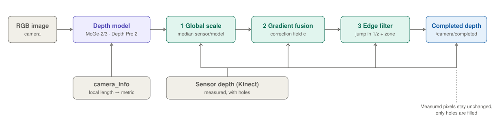
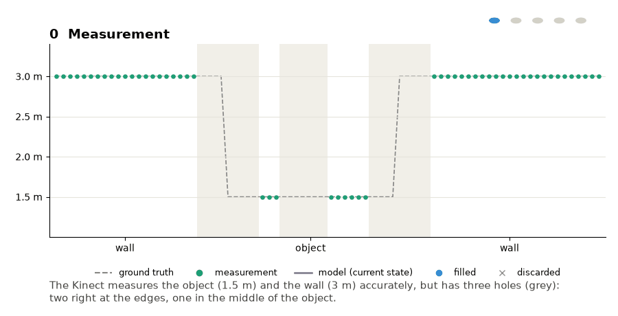
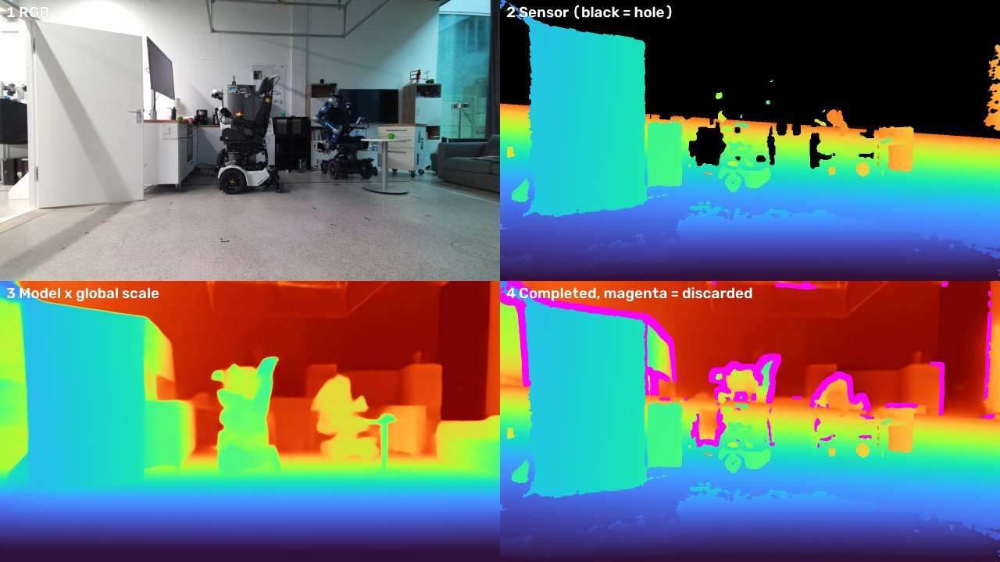
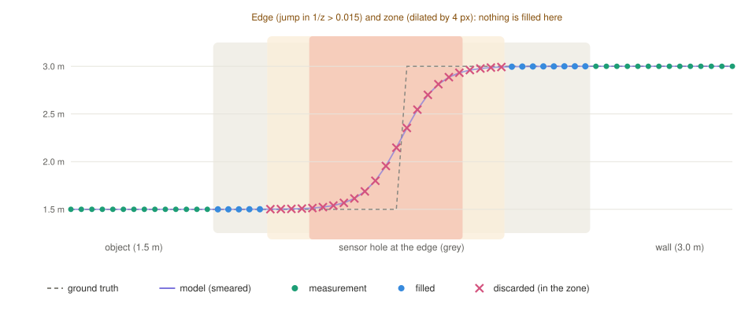
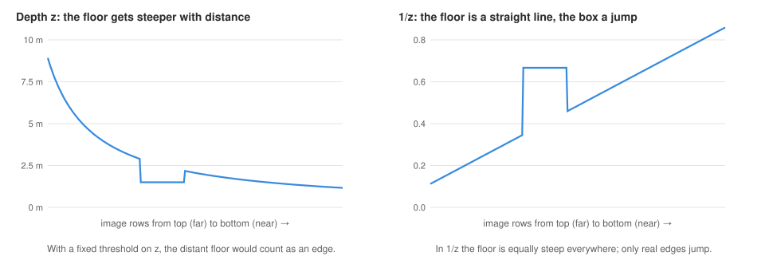
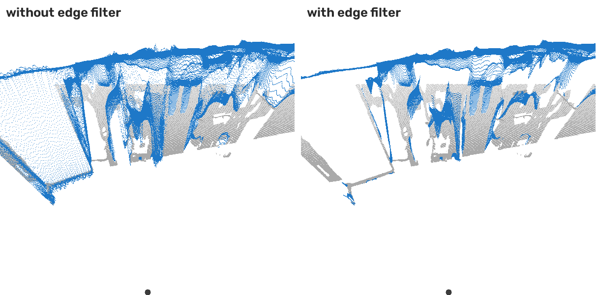

# Depth completion: filling Kinect depth with a learned model

The Azure Kinect measures depth very accurately but leaves many holes: at object edges, on dark
or shiny surfaces, at glass and beyond its range. In the map (nvblox) these would be regions
without information. Step 3 of the pipeline (`depth_completion_node.py`) fills these holes. A
monocular depth model estimates the depth from the RGB image, and this estimate is fitted to the
real measurements.

Ground rules:

- **Measured pixels always stay unchanged.** Only holes are filled.
- **When in doubt, a hole stays a hole.** A missing point is harmless for the map, a wrong point
  floating in the air is not.



| Step | What happens | Code |
|---|---|---|
| Depth model | estimates a metric depth for **every** pixel from the RGB image | `depth_models.py` |
| 1 Global scale | brings the estimate roughly to the scale of the measurement | `depth_fusion.fill` |
| 2 Gradient fusion | fits the estimate locally to the measurements without destroying its shape | `depth_fusion.GradientFusion` |
| 3 Edge filter | discards filled pixels at depth edges that would end up as floating points | `depth_fusion.jump_edges` |

This is how it works on a single image row: an object at 1.5 m in front of a wall at 3 m, with
three holes in the measurement (simplified, 80 pixels instead of 1280):



## Installation

One conda env for node, viewer and benchmark with all models, for Linux with an NVIDIA GPU and
ROS 2 Jazzy.

- The Python version must match the ROS distribution (Jazzy: 3.12), otherwise `rclpy` cannot be
  imported.
- numpy must stay below 2, because the ROS message types are built against numpy 1.x. MoGe is
  therefore installed without dependencies and OpenCV kept below 4.12.

**1. Create the env**

```bash
conda create -y -n depthcompletion python=3.12
```

```bash
conda activate depthcompletion
```

**2. PyTorch** (choose the CUDA version matching the driver, see `nvidia-smi` and pytorch.org)

```bash
pip install torch torchvision --index-url https://download.pytorch.org/whl/cu128
```

**3. Common packages** (including `rerun-sdk` for the viewer)

```bash
pip install "numpy<2" "opencv-python-headless<4.12" scipy trimesh "huggingface-hub>=1.0" click requests tqdm pillow matplotlib rosbags rerun-sdk
```

**4. MoGe**

```bash
pip install "numpy<2" "utils3d_moge @ git+https://github.com/EasternJournalist/utils3d-moge.git@62f09d58509485564e24d5d9f6aac9ee9ebc0c37" "pipeline @ git+https://github.com/EasternJournalist/pipeline.git@1c511390d90226c00c101f34b84df26a0f8789b4"
```

```bash
pip install --no-deps "git+https://github.com/microsoft/MoGe.git@74fbce054ebed49800de42d0ad0e83495065719a"
```

**5. Depth Pro 2**

```bash
pip install "numpy<2" "git+https://github.com/apple-aiml-research/ml-depth-pro-2.git@aa389cbb0b74341664ed663a0966c859905cd6c0"
```

**6. Optional: MoGe-3 refinement** (CUDA only, needs the CUDA toolkit; without it MoGe-3 runs with
its base network)

```bash
pip install --no-build-isolation "git+https://github.com/JeffreyXiang/FlexGEMM.git@b2fadb29d41846c7981ade6801ffc689fae119cf"
```

**7. Check** (ROS sourced, in the repository root)

```bash
python -c "import torch, numpy, rclpy, sensor_msgs.msg; print(torch.cuda.is_available(), numpy.__version__)"
```

```bash
python -c "import sys; sys.path.insert(0, 'navigation/mapping/depth_completion'); from depth_models import load_model; print(load_model('moge', 600).dev)"
```

In an existing env, the viewer only needs Rerun in addition:

```bash
pip install rerun-sdk
```

The viewer opens its own Rerun window and therefore needs a display. Without a display (e.g. over
SSH), record with `--save f.rrd` and open the file later with `rerun f.rrd`.

The weights are downloaded on the first start (`~/.cache/huggingface`,
`~/.cache/torch/hub/checkpoints`). In the LN process manager, enter the env's Python directly
(`<conda>/envs/depthcompletion/bin/python`), not `conda run`.

## Example

A recording from the lab (MoGe-2 B, 600 tokens):



1. **RGB**: the camera image the model estimates from.
2. **Sensor**: Kinect depth. Black are holes, here 37 % of the image. Everything beyond the range
   is missing at the top, plus holes at the wheelchairs and at edges.
3. **Model × global scale**: the estimate covers the whole image, edges are soft.
4. **Completed**: measurement plus filled holes. Magenta are the pixels discarded by the edge
   filter; they stay empty. Here 95 % of the image is filled and 5 % discarded.

## Depth estimation: available models

All models are behind one common interface in `depth_models.py`:

```python
model = load_model("moge", num_tokens=600)
depth = model(rgb, fov_x)   # RGB (H, W, 3) and field of view -> depth [m] per pixel, invalid = inf
```

The model gets the RGB image and the horizontal field of view of the camera. The field of view is
computed from the focal length in `camera_info`. With the real focal length the models return
**metric** depth in metres instead of only relative depth. How the networks work internally does
not matter here; what matters is that they get the shape of the scene right, but scale and edges
not perfectly.

| Name | Model | Package | Note |
|---|---|---|---|
| `moge2-s` | MoGe-2 vits-normal | `moge` | fastest |
| `moge2-b` | MoGe-2 vitb-normal | `moge` | fast, but clearly more gross errors in large holes |
| **`moge`** | **MoGe-2 vitl** | `moge` | **default of the ROS node** (600 tokens, 29 Hz on the A6000) |
| `moge2-l-normal` | MoGe-2 vitl-normal | `moge` | like `moge`, with an additional normal head |
| `moge3-l` | MoGe-3 vitl | `moge` | refinement only with CUDA, otherwise base network only |
| `depthpro2-s` | Apple Depth Pro 2 S | `depth_pro_2` | weights for research use only |
| `depthpro2-b` | Apple Depth Pro 2 B | `depth_pro_2` | weights for research use only |
| `depthpro2-l` | Apple Depth Pro 2 L | `depth_pro_2` | most accurate, weights for research use only |
| `depthpro2-h` | Apple Depth Pro 2 H+ | `depth_pro_2` | very large (3.5 GB) |

Runtime and accuracy of the models: [bench/README.md](bench/README.md).

Settings:

- **MoGe**: `num_tokens` sets the resolution the network works at. More tokens means slower, but
  not reliably more accurate: on the robot's A6000, MoGe-2 L was more accurate with 600 tokens
  than with 1200 or 2400. The output always has the full image size.
- **Depth Pro 2**: always works at full resolution and runs in **streaming mode** by default: the
  model also sees the previous images (window `STREAM_WINDOW`, default 4 including the current
  one) and becomes steadier over time. This costs time; on the M4 Pro, Depth Pro 2 S needs
  184 ms instead of 134 ms per image, 312 ms with window 16. In return, streaming halves the
  flicker of the completed depth with a static camera: 1.91 % (single frame) → 0.89 % (window
  4) → 0.80 % (window 16), less than MoGe-2 (1.2–1.5 %). With window 4 the accuracy stays the
  same (large holes 1.67 % instead of 1.64 %), with window 16 it drops slightly (1.79 %, more
  gross errors). Single frames: `STREAM = False` in the node, `--per-frame` in the viewer. For
  comparable numbers the offline benchmark uses single frames by default (streaming with
  `--stream`).
- **Selection**: at the top of the ROS node `MODEL`, `NUM_TOKENS`, `STREAM`, `STREAM_WINDOW`; in
  the viewer `--model`, `--num-tokens`, `--per-frame`, `--window`.

Pixels the model itself marks as invalid (e.g. sky) or that are farther than 50 m get `inf` and
are not filled.

## Fusion: fitting the estimate to the measurement

The model depth M has two typical errors. Its **scale** is off by a few percent, and not by the
same amount everywhere: an object can be 5 % too close and the wall behind it 4 % too far. Its
**shape** (which surface is flat, where an edge is), on the other hand, is good. The fusion
therefore takes the shape from the model and the scale from the measurement.

### Step 1: global scale

The median of measurement/model over all pixels where both exist gives a factor s. It is smoothed
over time (`ema = 0.3`) so that it does not jump. After this the estimate is right on average,
but not yet locally.

### Step 2: gradient fusion with a correction field

We look for a correction field c such that the completed image is D = M · exp(c). The computation
runs in log depth, so c is a relative factor: c = 0.05 means 5 % farther away. c has to satisfy
three things at the same time:

1. **Match the measurement**: where the Kinect measures, c ≈ r = log Z − log M.
2. **Smooth along surfaces**: neighbouring pixels should have almost the same c, but **not across
   edges** of the model. At an edge the coupling becomes weak (weight
   exp(−|Δ log M| / `sigma_edge`)), so the object gets its own correction and the wall its own.
3. **Decay**: without measurements nearby, c is slowly pulled to 0, more strongly beyond the
   range. There the model depth with the global scale remains.

This is a linear least-squares problem. It is easiest to see on a single image row. The curves
below are computed with exactly this equation, not drawn:


- **a)** The model (violet) has the right shape but is too close at the object and too far at the
  wall. The Kinect (green) has a hole in the object (yellow) and measures nothing on the right
  (grey).
- **b)** Green is how far the model is off at each measurement (r). The solution c (orange)
  follows these points. In the hole it is bridged smoothly, at the object edge it jumps along,
  and on the right it decays to 0.
- **c)** Result: the measurement stays, the hole in the object is filled to within 1 % (without
  correction the error would be 9.5 %). On the right, without any measurement nearby, the model
  error remains; no fusion can correct it there.

Implementation (`GradientFusion`):

- The computation runs on a grid with half the resolution (`down = 2`). Each grid cell gets a
  measurement weight from coverage, sensor accuracy (drops with 1/z² beyond 4 m), spread within
  the cell (edges) and an outlier check against the median.
- It is solved with preconditioned CG (conjugate gradients) on the GPU, 40 iterations. The start
  value is the c of the last frame, which speeds up live operation.
- A second pass with Huber weights damps individual wrong measurements.
- c is brought to full resolution edge-preserving: when upsampling, only grid points with a
  similar model depth count, so that c does not smear across edges.

| Parameter | Default | Meaning |
|---|---|---|
| `down` | 2 | grid downsampling |
| `lam` | 1.0 | strength of the smoothness |
| `sigma_edge` | 0.05 | jump in log M at which an edge releases the coupling |
| `mu_near`, `mu_far`, `far_band` | 1e-4, 0.005, 0.15 | decay near / behind the measured range |
| `z_ref` | 4.0 m | beyond this, trust in the measurement drops with 1/z² |
| `outlier` | 1.0 | outlier threshold (log units) |
| `iters` | 40 | CG iterations |

### Step 3: edge filter against floating points

The model does not draw a depth jump as a step but as a **soft ramp** over 10 to 30 pixels, like
a blurred photo. Exactly at edges the Kinect often measures nothing. Without a filter the ramp
would be filled in: values such as 1.9 m or 2.4 m between an object at 1.5 m and the wall at 3 m.
In the map these are points floating in the air between object and wall (edge bleeding).

The filter does three simple steps: **find the edge → zone around the edge → fill nothing
there.**

1. **Find the edge**: in the corrected model depth, each pixel checks how much 1/depth changes in
   its 5×5 window. If it jumps by more than `edge_jump` (0.015 1/m), there is an edge. The jump
   from 1.5 m to 3 m is 0.67 → 0.33 in 1/depth, far above.
2. **Zone**: the edge is dilated by `edge_grow` (4 px), so that the flat ends of the ramp are
   included.
3. **Do not fill**: filled pixels in the zone are discarded and stay empty. Measured pixels
   always stay.



**Why 1/depth and not the depth itself?** The floor runs flat away from the camera. In depth it
gets steeper and steeper with distance, and a fixed threshold would discard the distant floor as
an edge. In 1/depth every planar surface is a straight line: the floor is equally steep at every
distance and stays below the threshold; only real edges jump above it.



This is what it looks like in 3D from above. Grey is measured, blue filled, the floor is hidden:



Without the filter (left), veils of filled points hang between the objects and the wall. With the
filter (right) they are gone; the filled surfaces inside the objects remain.

**Limits**

- In the zone around edges the depth stays empty. Of the holes directly at depth edges, about one
  fifth is filled (21 %). A small residue remains: 0.04 % of the edge pixels are still filled with
  more than 10 % error. With `edge_grow=8` it is 0 %, but 7 percentage points fewer of the real
  holes are filled.
- Very close surfaces seen almost exactly from the side (e.g. a wall the robot drives along at
  less than ~0.5 m) also change strongly in 1/depth and are discarded as an edge. On the left of
  the top view, a surface seen at a grazing angle disappears, probably such a case.

| Parameter | Default | Meaning |
|---|---|---|
| `edge_jump` | 0.015 1/m | jump in 1/depth (in the 5×5 window) above which there is an edge, 0 = filter off |
| `edge_grow` | 4 px | width of the zone around an edge in which nothing is filled (8 px: no bleeding, but less area) |

## ROS node

`depth_completion_node.py` follows the communication rules of the pipeline
([../README.md](../README.md#communication)): one thread, no timer, the raw depth is the trigger.
It keeps the last colour image and the last depth image and processes a frame as soon as both
have the same stamp. It publishes only `/camera/completed/depth/image_raw`; colour and
`camera_info` are taken from the bridge by the later stages. Every 5 s it logs:

```
completion: in 14.2 Hz | out 8.1 Hz | latency 180 ms | convert 0.6 | model 53.0 | fusion 12.1 | publish 1.4 ms
```

## Code and tools

| File | Content |
|---|---|
| `depth_models.py` | models, `load_model(name)` |
| `depth_fusion.py` | `fill` (steps 1–3), `global_scale`, `GradientFusion`, `jump_edges` |
| `depth_completion_node.py` | ROS node (step 3 of the pipeline) |
| `viewer.py` | Rerun window: RGB, sensor, model and merged depth plus one 3D point cloud each; live via ROS or offline with `--frames f.npz`. Discarded pixels magenta, filled points in RGB (orange with `--mark-filled`), filter switchable with `--set edge_jump=0`, `--eval` shows the error below 3 m as a curve |
| `bench/` | offline benchmark without ROS, with its own documentation and all results: [bench/README.md](bench/README.md) |

```bash
python navigation/mapping/depth_completion/viewer.py --model moge --num-tokens 600
```
